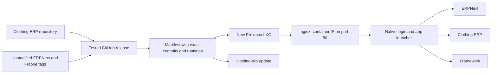

# Independent source, one installed system

“Separate” means separate applications/repositories and independent upstream pins.
The apps share Frappe's authentication, database and standard business documents.
A second fake ERP service or duplicated stock/accounting database is not involved.

Each published release contains an app source archive and `release.json` describing
its exact Clothing ERP source commit, ERPNext/Frappe tag commits, Python, Node,
Bench and uv versions. A source checksum and SHA256SUMS detect artifact corruption;
GitHub Actions also publishes provenance attestations. Normal installation uses
GitHub's HTTPS release-asset endpoints. Local clients do not currently verify the
Sigstore attestation; checksums alone are not an independent publisher signature.

The update manager prepares a new native bench under `/home/frappe/releases/`.
Each bench owns its three app checkouts, Python environment, Node runtime and built
assets. The common site files are shared; a single symlink selects the active bench.
Native systemd services and nginx use that stable symlink. Core updates therefore
need no merges into the clothing repository and no dependency replacement inside
an actively serving environment.

Migrations change the shared database. They run only with all application writers
stopped and the HTTP maintenance gate closed, after a database/config/file backup.
Before the activation commit point, failure restores the old database, attachments,
queue snapshot and code.
After frontend readiness is confirmed and the release is committed, background
writers are started; recovery after that point repairs the new services without
silently discarding their writes. Explicit rollback saves a new recovery point and
then restores the selected previous code/data/queue together.

This follows Frappe's rule that reverse schema migrations are unsupported:
[official migration documentation](https://docs.frappe.io/framework/user/en/database-migrations).
Proxmox uses the [native container toolkit](https://pve.proxmox.com/pve-docs/pct.1.html);
Docker nesting is not needed inside the LXC.
