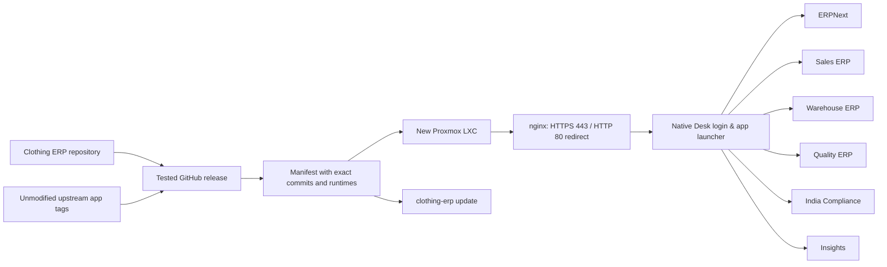
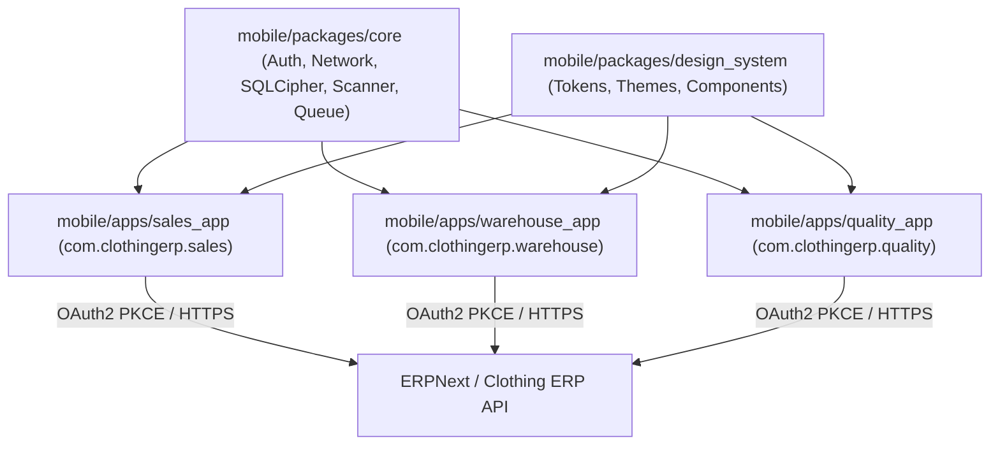

# Independent source, one installed system

“Separate” means separate applications/repositories and independent upstream pins.
The apps share Frappe's authentication, database and standard business documents.
A second fake ERP service or duplicated stock/accounting database is not involved.

### Authoritative App and DocType Ownership

1. **`sales_erp` (Field Sales & Distribution)**:
   - Authoritative Sales DocTypes: `ASM Supervision` (Sales Territory Assignment), `Retailer Application`, `Retailer Visit`, `RSM Visit Obligation`, `Retailer Credit Limit Request`, `Retailer Assignment History`, `Clothing Product Image`.
   - Authoritative services: Territory-based order placement, catalogue matrices, product gallery lifecycle and sweeps, credit limit approval workflow with live customer limit validation, 80-day RSM visit cadence & obligations.
2. **`warehouse_erp` (Fulfilment & Warehouse Operations)**:
   - Authoritative services: Scan verification, Pick List shortage resolution, Pick List completion, Delivery Note validation, nested warehouse tree scoping, and Serial and Batch Bundle row locking.
   - Canonical roles: `Clothing Warehouse Manager` (mutation authority), `Clothing Business Administrator` (global oversight), with audited migration path for legacy operator accounts.
3. **`quality_erp` (Supplier Quality & Returns Quarantine)**:
   - Authoritative Quality DocTypes: `Supplier Quality Inspection`, `Return Quarantine`.
   - Authoritative services: 7-stage sequential quality lifecycle enforcement (Fit Sample $\rightarrow$ Refit Sample $\rightarrow$ Size Set $\rightarrow$ Production Go Ahead $\rightarrow$ Inline Visits $\rightarrow$ Mid-line Visits $\rightarrow$ Final Inspection), versioned inspection reports, and administrative review bundle retrieval.

Each published release contains an app source archive and `release.json` describing
its exact Clothing ERP source commit, ERPNext/Frappe/Insights/India Compliance
tag commits, Python, Node,
Bench and uv versions, plus checksummed runtime dependency locks. A source checksum and SHA256SUMS detect artifact corruption;
GitHub Actions also publishes provenance attestations. Normal installation uses
GitHub's HTTPS release-asset endpoints. Local clients do not currently verify the
Sigstore attestation; checksums alone are not an independent publisher signature.

The update manager prepares a new native bench under `/home/frappe/releases/`.
Each bench owns all suite app checkouts (`sales_erp`, `warehouse_erp`, `quality_erp`), upstream apps, Python environment, Node runtime and built
assets. The common site files are shared; a single symlink selects the active bench.
Native systemd services and nginx use that stable symlink. Core updates therefore
need no merges into the clothing repository and no dependency replacement inside
an actively serving environment.

Migrations change the shared database. They run only with all application writers
stopped and the HTTP maintenance gate closed, after a database/config/file backup.
Before the activation commit point, failure restores the old database, attachments,
queue snapshot and code.
After frontend readiness is confirmed and the release is committed, background
writers are started; recovery after that point repairs the new services without
silently discarding their writes. Explicit rollback saves a new recovery point and
then restores the selected previous code/data/queue together.

This follows Frappe's rule that reverse schema migrations are unsupported:
[official migration documentation](https://docs.frappe.io/framework/user/en/database-migrations).
Proxmox uses the [native container toolkit](https://pve.proxmox.com/pve-docs/pct.1.html);
Docker nesting is not needed inside the LXC.

---

### Mobile Architecture & Multi-Target Foundation

The mobile suite is organized as an independent Dart/Flutter monorepo located in `mobile/`, managed with Melos:

1. **Target Separation & Minimum Versions**:
   - **Clothing Sales Mobile** (`com.clothingerp.sales`): Dedicated to Area Sales Managers (ASM) and Regional Sales Managers (RSM).
   - **Clothing Warehouse Mobile** (`com.clothingerp.warehouse`): Dedicated to Warehouse Managers and fulfillment operators.
   - **Clothing Quality Mobile** (`com.clothingerp.quality`): Dedicated to Quality Inspectors and Quality Managers.
   - Minimum Supported Platforms: Android SDK 28 (Android 9.0+) and iOS 15.0+.

2. **Security & Cryptography Doctrine**:
   - **OAuth 2.0 with PKCE (RFC 7636)**: Uses SHA-256 code challenge and high-entropy verifier; zero user passwords or Administrator secrets stored on client devices.
   - **Hardware-Backed Secure Storage**: Refresh tokens and database encryption keys stored exclusively in Apple Keychain (`kSecAttrAccessibleAfterFirstUnlockThisDeviceOnly`) and Android Keystore (`EncryptedSharedPreferences` with AES-256 GCM).
   - **Encrypted Local Storage (SQLCipher)**: Full local database encrypted with AES-256 using keys derived from hardware secure storage. Complete cryptographic wipe upon logout or remote revocation.
   - **Strict TLS & Hostname Validation**: All network traffic requires HTTPS with strict hostname matching and certificate verification. Zero "trust-all-certificates" bypasses allowed.

3. **Offline Queue & Concurrency Model**:
   - Mutations are enqueued into an encrypted local queue with client-generated UUID v4 idempotency keys.
   - Server state and business permissions are strictly revalidated on sync; offline queue state never authorizes transactions.
   - Business conflicts (e.g. concurrency changes, expired batches, over-picks) transition items to `conflict` state, halting retries until explicit user resolution.

4. **Hardware Scanner & Peripheral Subsystem**:
   - Keyboard-wedge listener detects rapid character pulses (<50ms inter-character interval).
   - OEM broadcast intent binding for rugged warehouse handhelds (Zebra DataWedge, Honeywell Mobility Edge).
   - Camera barcode scanner with torch/flashlight control and multi-sensory feedback (synth audio, haptic vibration, visual status colors).
   - Safe photo intake with client-side EXIF/GPS stripping, 2MB size bounding, and SHA-256 cryptographic hashing.

5. **Clothing Sales Mobile Implementation (`com.clothingerp.sales`)**:
   - ASM/RSM territory-scoped dashboard with zero cross-territory data exposure.
   - Retailer directory & detail with navigation handoff, exposure metrics, and 120-day collection hard block indicators.
   - Retailer onboarding with draft save/resume, multi-photo private evidence (`SafePhotoManager`), and RSM commercial review workflows.
   - Visit obligations and geolocation check-in verification with anti-spoofing and storefront photo evidence.
   - Offline-capable catalogue subset with visible stale data indicators; prices and stock are strictly non-authoritative.
   - Shopping cart with server-side repricing preflight, exposure verification, UUID v4 idempotency, and offline queueing.
   - 90–120 day collection worklist derived from native ERPNext Accounts Receivable with zero payment secrets.
   - Delivery follow-up confirmation with carton barcode verification.
   - RSM supervision view with ASM capacity guidance (~3-4 ASMs, ~200-250 shops) and zero user-management authority.

6. **Clothing Warehouse Mobile Implementation (`com.clothingerp.warehouse`)**:
   - Manager-only operational model: scopes work strictly to assigned Warehouses; rejects retired operators with immediate session wipe.
   - Wave and route work queues for picking, packing, dispatch, customer returns, and refurbishment.
   - Camera and hardware keyboard-wedge scanner (<50ms burst) with permanent scan focus, quantity/remaining display, serial/batch detail, and undo unsubmitted scan.
   - Offline scan queue with server reconciliation: Pick List completion, Delivery Note creation, and dispatch remain strictly BLOCKED until online reconciliation succeeds with zero conflicts.
   - Partial pick shortage split, backorders, carton packaging with dimensions (L/W/H/UOM) and weights (gross/net in kg), and packing slip generation.
   - Carrier handoff recording (carrier, vehicle no, LR no, driver contact, handler acceptance, proof photo) and manifest generation.
   - Customer returns intake against original Delivery Note with returnable quantity validation, reason/condition, and quarantine warehouse isolation.
   - Refurbishment queue with technician operation assignment and post-refurbishment reinspection quality gate (restocking to saleable inventory is BLOCKED unless reinspection has Passed).
   - Safe Bluetooth/Network thermal printer integration: verifies payloads to assert zero passwords, tokens, or financial secrets; enforces reprint tracking and watermarks.

7. **Clothing Quality Mobile Implementation (`com.clothingerp.quality`)**:
   - Quality Inspector, Quality Manager, and Administrator role scoping with Supplier and Company isolation.
   - Sequential 7-stage quality lifecycle enforcement (Fit Sample $\rightarrow$ Refit Sample $\rightarrow$ Size Set $\rightarrow$ Production Go Ahead $\rightarrow$ Inline Visits $\rightarrow$ Mid-line Visits $\rightarrow$ Final Inspection).
   - Multiple Inline (stage 5) and Mid-line (stage 6) visits support with incremented visit numbers.
   - Versioned checklist completion, measurement tolerance variances against spec targets, and defect severity classification.
   - Captioned private photographs via SafePhotoManager (EXIF stripping, 2MB size cap, SHA-256 checksums).
   - Side-by-side revision comparison diffs, correction requests, and resubmission trails.
   - Return quarantine decisions, disposition recommendations (`Scrap`, `Seconds Sale`, `Supplier Claim`, `On Hold`), and post-refurbishment reinspection clearance.
   - High-risk Administrator gate review on mobile: strictly BLOCKED while offline, requires exact immutable review bundle with bundle SHA-256 hash, and requires strong reauthentication.
   - Controlled report viewing: ephemeral device storage, HMAC token expiry (15m), viewer watermarking, zero permanent private URLs, and automatic cache wiping.
