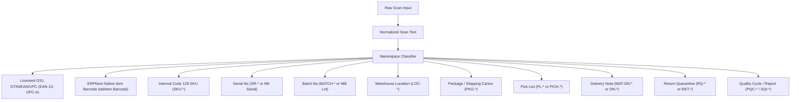

# Barcode, QR and Label Architecture Specification

Status: Canonical specification for Clothing ERP Suite (`sales_erp`, `warehouse_erp`, `quality_erp`).

## 1. Core Security Principle: Identification vs. Authorization

> [!IMPORTANT]
> **A barcode is strictly an object identifier, never an authorization token.**
> 
> Scanning a barcode identifies *what* physical object is present. It does **not** authorize an operation, grant access, or bypass business workflows. Every scan submitted to the server must independently revalidate:
> - The authenticated user and active roles;
> - The user's assigned Warehouse (for warehouse managers), Territory (for sales staff), or Company/Supplier boundaries (for quality staff);
> - The target document status and workflow transition rules;
> - The remaining quantity, allocated Serial/Batch identity, and tracking bounds;
> - Concurrency locks (`SELECT ... FOR UPDATE`) to prevent race conditions or double-fulfillment.
> 
> **Never embed in a barcode or QR code**:
> - User credentials, session tokens, or API secrets;
> - Private file download URLs or unauthenticated deep links;
> - Customer Personally Identifiable Information (PII) such as phone numbers, personal email, or private addresses;
> - Unprotected commercial pricing, dealer discount rates, or profit margins;
> - Business approval authority or cryptographic bypass signatures.

---

## 2. Identifier Namespaces and Symbologies

Clothing ERP enforces strict separation between eleven distinct identifier namespaces. This prevents cross-type collisions, ambiguous lookups, and malicious enumeration.



### Namespace Definitions

| Namespace | Default Symbology | Format Pattern | Check Digit | Source Authority | Description |
|---|---|---|---|---|---|
| **Licensed GS1 GTIN / EAN / UPC** | EAN-13 / UPC-A | `^\d{8}$`, `^\d{12,14}$` | Modulo 10 (GS1 standard) | GS1 Registered Supplier | Globally unique commercial barcodes assigned to garments by brands or mills with licensed GS1 company prefixes. |
| **ERPNext Item Barcode** | EAN-13 or Code 128 | Alphanumeric (1–140 chars) | As per type | `tabItem Barcode` | Existing barcode values registered in native ERPNext Item child tables. |
| **Internal Code 128 SKU** | Code 128 | `^SKU-[A-Za-z0-9_-]+$` | Modulo 103 (Code 128) | Clothing ERP Generator | Standard internal identifier for garment items and size variants (`SKU-<ItemCode>-<Size>`). |
| **Serial No** | Code 128 / Data Matrix | `^SR-[A-Za-z0-9_-]+$` or mfr | Optional | `tabSerial No` | Unit-level unique garment serials for high-value items or warranty tracking. |
| **Batch No** | Code 128 | `^BATCH-[A-Za-z0-9_-]+$` or lot | None | `tabBatch` | Dye lot, fabric roll, or production batch identifier. |
| **Warehouse Location** | Code 128 | `^LOC-[A-Za-z0-9_-]+$` | None | `tabWarehouse` | Warehouse bin, aisle, shelf, or rack identifier (`LOC-<Warehouse>-<Aisle>-<Shelf>-<Bin>`). |
| **Package / Carton** | Code 128 | `^PKG-[A-Za-z0-9_-]+$` | None | `tabPacking Slip` | Outer shipping box / carton identifier (`PKG-<DeliveryNote>-<CaseNo>`). |
| **Pick List** | Code 128 / QR | `^(PL-\d{4}-\d+|PICK-[A-Za-z0-9_-]+)$` | None | `tabPick List` | Warehouse picking instruction document reference. |
| **Delivery Note** | Code 128 / QR | `^(MAT-DN-\d{4}-\d+|DN-[A-Za-z0-9_-]+)$` | None | `tabDelivery Note` | Native dispatch document reference. |
| **Return Quarantine** | Code 128 | `^(RQ-\d{4}-\d+|RET-[A-Za-z0-9_-]+)$` | None | `tabReturn Quarantine` | Inward customer return quarantine tag identifier. |
| **Quality Cycle / Report** | Code 128 / QR | `^(PQC-\d{4}-\d+|SQI-\d{4}-\d+)$` | None | `tabProduction Quality Cycle` / `tabSupplier Quality Inspection` | Supplier pre-production and factory inspection records. |

---

## 3. Check-Digit Algorithms and Standards Compliance

### Rule: Never Fake Global EAN Numbers
> [!CAUTION]
> **Never generate random EAN-13 numbers and claim they are globally valid.**
> Generating pseudo-random 13-digit numbers without an authorized GS1 Company Prefix violates international supply chain standards and risks commercial collisions with external products at retail points of sale.
> 
> - **Internal Identifiers**: Must use the `SKU-` namespace encoded in **Code 128**. Code 128 natively supports the full ASCII charset, high density, and automatic Modulo-103 checksums.
> - **GS1 EAN-13 / UPC-A**: Only accepted when entered from an official manufacturer or brand possessing an assigned GS1 prefix. Every scanned or entered EAN-13 must strictly validate its standard **Modulo 10** check digit before database lookup.

### GS1 Modulo 10 Check Digit Calculation
For a 12-digit base string $d_1 d_2 \dots d_{12}$ forming a 13-digit EAN-13 code $d_1 d_2 \dots d_{13}$:
1. Sum the digits in odd positions (from right to left, excluding check digit): weights 1 and 3 alternately.
   $$\text{Sum} = \sum_{i=1}^{12} d_i \times (1 \text{ if } i \text{ is odd else } 3)$$
2. The check digit $d_{13}$ is:
   $$d_{13} = (10 - (\text{Sum} \bmod 10)) \bmod 10$$
Scans failing this checksum are immediately rejected with error code `INVALID_CHECK_DIGIT`.

---

## 4. Server-Side Barcode Allocation and Immutability

1. **Collision-Safe Server Allocation**:
   - Internal barcodes are generated on the server using deterministic prefixes and collision checks against `tabItem Barcode`, `tabItem`, `tabSerial No`, and `tabBatch`.
   - Allocation uses database unique indexing to guarantee zero race condition duplication.
2. **Immutable Assignment**:
   - Once assigned to an Item variant, a barcode cannot be silently replaced, overwritten, or reassigned.
   - If an item barcode requires correction, an explicit administrative override action is logged in `tabActivity Log`.
3. **Single & Bounded Bulk Generation**:
   - Single item generation: creates barcode for a specific item code and size variant.
   - Bulk generation: bounded to maximum 500 items per request to protect worker processes from starvation.

---

## 5. Unified Server-Side Scan Resolver (`resolve_scan`)

A single typed entry point resolves all scan inputs across web and mobile:

```python
resolve_scan(
    scan_text: str,
    operation_context: str | None = None,  # "picking" | "packing" | "dispatch" | "returns" | "refurbishment" | "quality" | "catalogue" | "location"
    warehouse: str | None = None,
    document_type: str | None = None,
    document_name: str | None = None,
    expected_item: str | None = None,
) -> dict
```

### Typed Response Schema
```json
{
  "success": true,
  "scan_text": "SKU-TSHIRT-BLK-M",
  "namespace": "internal_sku",
  "entity_type": "item",
  "data": {
    "item_code": "TSHIRT-BLK-M",
    "item_name": "Classic Crewneck Tee Black M",
    "barcode": "SKU-TSHIRT-BLK-M",
    "uom": "Nos",
    "has_batch_no": 0,
    "has_serial_no": 0
  },
  "context_valid": true,
  "feedback": {
    "status": "valid",
    "message": "Item verified: Classic Crewneck Tee Black M",
    "audio": "beep_success",
    "color": "green"
  }
}
```

### Contextual Error Enforcement
- **`WRONG_ITEM`**: Scanned item does not match row item required by the Pick List.
- **`WRONG_SIZE`**: Scanned variant size differs from required order line.
- **`EXPIRED_BATCH`**: Scanned Batch No has passed its expiration date.
- **`ALREADY_PICKED` / `OVER_PICK`**: Scanned item quantity exceeds remaining unpicked quantity on row.
- **`OVER_RETURN`**: Return scan exceeds remaining delivered quantity.
- **`UNAUTHORIZED_WAREHOUSE`**: Scanned location or item warehouse is outside manager's assigned warehouses.

---

## 6. Web and Mobile Scanner Interface

1. **Dual Scanning Modes**:
   - **Hardware Keyboard-Wedge Scanner**: Listens for rapid keypress sequences (< 50ms inter-character latency) followed by `Enter`. Prevents keyboard-wedge keystrokes from bleeding into ordinary form fields.
   - **Camera Scanning**: Mobile camera stream using native Barcode Detection API with HTML5 camera fallback.
2. **Debounce & Duplicate Suppression**:
   - Suppresses duplicate scans of the exact same identifier within a 1.5-second cooldown window to prevent unintended double-scans from unsteady hands.
   - Instant debounce reset when a different barcode is scanned.
3. **Continuous Scanning Mode**:
   - Allows warehouse operators to rapidly scan successive garments without requiring manual UI dismissal between items.
4. **Multi-Sensory Feedback**:
   - **Audio**: Web Audio API synthesized tones (880 Hz clean high beep for success; 220 Hz low double buzz for failure).
   - **Haptic**: Device vibration (`[100ms]` for success; `[100ms, 50ms, 100ms]` for failure).
   - **Visual**: Flash border / color feedback (green for valid; red for error; yellow for warning).
5. **Accessible Manual Fallback**:
   - Permanent keyboard input field with standard ARIA live region announcements (`aria-live="polite"`) for vision-impaired operators and damaged barcodes.

---

## 7. Deterministic Labels, Printing and Reprint Audit

1. **Formats Supported**:
   - **Deterministic PDF**: Scaled for standard thermal label stock (4x6 inch and 2x1 inch) via headless WeasyPrint.
   - **Reviewed ZPL II**: Direct thermal printer commands (`^XA ... ^XZ`, `^PW812`, Code 128 `^BC`) for zero-latency Zebra industrial printers.
2. **Reprint Audit**:
   - First print records initial print date and user in `tabActivity Log`.
   - Subsequent prints automatically increment reprint counter and superimpose a prominent `REPRINT #N` watermark banner on both PDF and ZPL outputs.
3. **Permission-Aware Downloads**:
   - Endpoint strictly validates document permissions and warehouse assignment before serving label streams.
