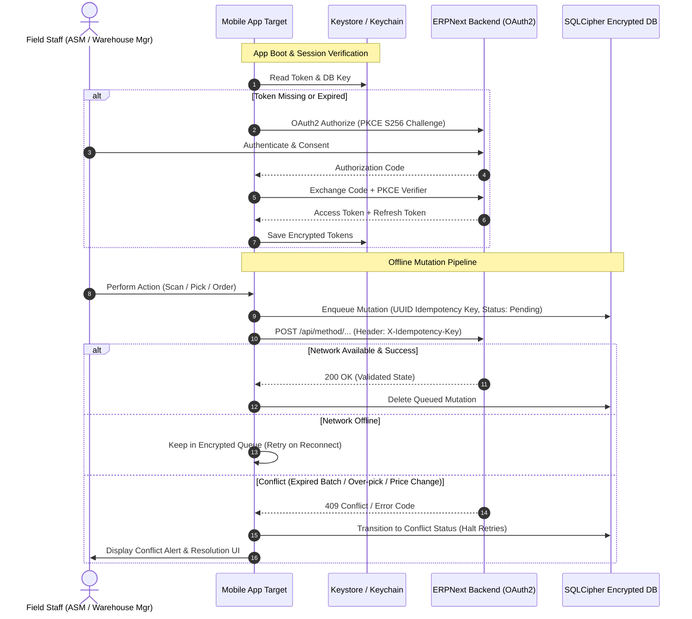
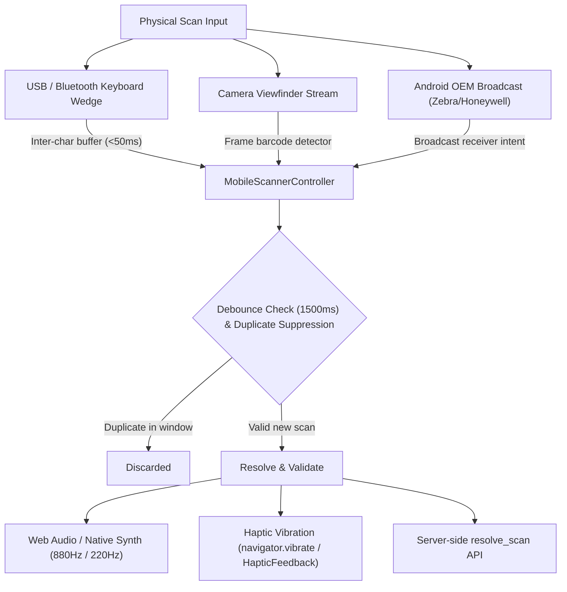

# Clothing ERP Mobile Suite Architecture

## 1. Monorepo Structure

```
clothing_erp/mobile/
├── melos.yaml                      # Multi-package monorepo workspace configuration
├── pubspec.yaml                    # Workspace root
├── analysis_options.yaml           # Strict static analysis rules (no dynamic, null safety)
├── .fvmrc                          # Flutter SDK version pin (3.24.5)
├── docs/                           # Architecture, security & signing guidelines
│   ├── mobile-architecture.md
│   └── signing-and-distribution.md
├── scripts/                        # Mobile SBOM and supply-chain scanners
│   ├── generate_mobile_sbom.py
│   └── scan_mobile_dependencies.py
├── packages/                       # Shared reusable foundation packages
│   ├── core/                       # Auth, networking, encrypted DB, offline queue, scanner
│   │   ├── pubspec.yaml
│   │   └── lib/
│   │       ├── clothing_core.dart
│   │       └── src/
│   │           ├── accessibility/  # 48dp touch targets, semantic announcements
│   │           ├── auth/           # OAuth2 PKCE, KeyStore/KeyChain, session lifecycle
│   │           ├── l10n/           # English, Hindi, Marathi, Tamil, Bengali
│   │           ├── media/          # Safe photo compression, EXIF stripping, SHA-256
│   │           ├── network/        # Versioned API client, TLS, pagination, errors
│   │           ├── scanner/        # Keyboard-wedge buffer, camera, broadcast intents
│   │           └── storage/        # SQLCipher encrypted DB, UUID offline queue
│   └── design_system/              # UI tokens, themes, viewfinders, status badges
│       ├── pubspec.yaml
│       └── lib/
│           └── clothing_design_system.dart
└── apps/                           # Three separate application targets
    ├── sales_app/                  # com.clothingerp.sales (ASM/RSM)
    ├── warehouse_app/              # com.clothingerp.warehouse (Warehouse Manager)
    └── quality_app/                # com.clothingerp.quality (Quality Inspector/Manager)
```

---

## 2. Security Boundaries & Authentication Flow



---

## 3. Peripheral Scanner Subsystem



---

## 4. Minimum Supported Standards
- **Android**: Min SDK 28 (Android 9.0 Pie), Target SDK 34 (Android 14).
- **iOS**: Min iOS 15.0, Target iOS 17+.
- **Database**: SQLCipher 256-bit AES.
- **Network**: Strict TLS 1.2+ with hostname verification; zero trust-all-certificates bypass.
- **Idempotency**: UUID v4 client keys bound to server mutation transactions.
